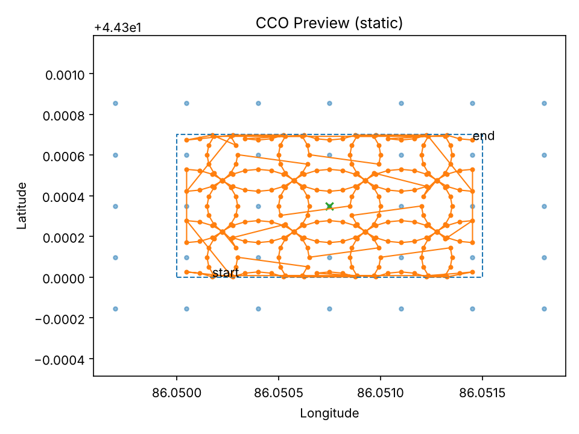

# CCO Flight Planner

English | [中文](README.zh-CN.md)

Generates cross-circular oblique (CCO) flight routes for DJI drones from a field boundary. A grid of equal circles is laid over a KML polygon, each circle gets waypoints with the camera facing its centre, and the result is written as DJI WPML (`template.kml` + `waylines.wpml`) and packed as KMZ for DJI Pilot 2. Long missions are split into parts that fit the controller limit.

I use these routes to photograph field trials for 3-D reconstruction. Circular oblique views of every point give much better canopy side-walls in the point cloud than the usual nadir lawn-mower pattern, which is what plant height and canopy volume estimates depend on. DJI Pilot 2 has no built-in way to tile a whole field with circles, so I wrote this.



## Installation

Python 3.8 or newer.

```bash
git clone https://github.com/smiler488/cco-flight-planner.git
cd cco-flight-planner
pip install -r requirements.txt
```

The interactive window needs Tk 8.6 or newer (`python -m tkinter` should open a window) or PyQt5 / PySide6. Without either, the script falls back to text prompts and still saves a static `preview.png`.

## Usage

### Interactive

```bash
python create_wpml_kml_batch.py
```

Pick the field KML and an output folder. Adjust radius, waypoints per circle, overlap, grid rotation, altitude, speed and gimbal pitch in the window, then press **Apply & Generate**. **Open KML…** switches to another field without restarting. Closing the window without Apply writes nothing.

Keyboard: `Tab`/`↓` and `Shift+Tab`/`↑` select a slider, `←`/`→` nudge it, with `Shift` for ten times the step.

### Command line

```bash
python create_wpml_kml_batch.py --polygon examples/demo_field.kml \
  --circle_radius 20 --circle_overlap 0.3 --per_ring 24 \
  --alt 30 --gimbal -45 --speed 6 \
  --drone_enum 99 --drone_sub 1 --payload_enum 89 --payload_sub 0 --payload_pos 0 \
  --max_points 300 --out_dir output
```

Add `--preview_gui 1` to check and adjust the layout in the window before writing.

| Option | Default | Meaning |
|---|---|---|
| `--polygon` | required | KML with one `Polygon` (first one is used) |
| `--circle_radius` | 30 | circle radius, m |
| `--per_ring` | 60 | waypoints per circle |
| `--circle_overlap` | 0.3 | overlap between neighbouring circles; centre spacing = `2r(1 - overlap)` |
| `--center_step` | 0 | fixed centre spacing in m (0 = derived from radius and overlap) |
| `--cover_padding` | 10 | grow the field bounding box by this many metres before laying the grid |
| `--grid_bearing` | 0 | grid rotation, degrees clockwise; align it with the rows |
| `--start_bearing` | 0 | bearing of the first waypoint on each circle |
| `--clip_inside` | 1 | keep only waypoints inside the field |
| `--prune_outside` | 1 | with `--clip_inside 0`, drop circles that never enter the field |
| `--alt` / `--speed` / `--gimbal` | 50 / 6 / -45 | height above take-off (m), speed (m/s), gimbal pitch (deg) |
| `--file_suffix` | `LiangchaoDeng_SHZU` | added to every photo file name |
| `--max_points` | 300 | waypoints per sub-mission (0 = no split) |
| `--kmz`, `--pack_full_kmz`, `--pack_parts_kmz` | 1 | write KMZ files |
| `--center_mode` | `centroid` | grid origin: `centroid` or `bbox_center` |
| `--drone_enum` … `--payload_pos` | none | DJI device tags; left out of the files when not set |

The GUI starts with Matrice 4T tags (`99/1`, payload `89/0/0`). On the command line no device tags are written unless you pass them.

### Splitting an existing route

`split_wpml_kml_batch.py` cuts routes made elsewhere (DJI Pilot 2, DJI Terra, or this tool) into parts. `template.kml` and `waylines.wpml` are cut at the same indices and each part is packed as `partXX.kmz`:

```bash
python split_wpml_kml_batch.py --max 300 --out_dir splits \
  --inputs output/template.kml output/waylines.wpml
```

## Output

```
output/
├── template.kml      full mission
├── waylines.wpml
├── cco_full.kmz      wpmz/template.kml + wpmz/waylines.wpml + wpmz/res/
├── preview.png       field outline, circle centres and flight path
└── parts/            only when the mission exceeds --max_points
    ├── template_part01.kml / .wpml
    └── part01.kmz …
```

## Practical notes

- Heights are relative to the take-off point (`relativeToStartPoint`). Take off from a spot level with the field.
- Waypoints use "stop at point" turns and a take-photo action at each point. 24–36 waypoints per circle has been a good balance between overlap and flight time for me.
- With clipping on, circles near the boundary become arcs and the path jumps between arc ends. That is expected. Turn clipping off with pruning on if you want full circles at the edges.
- Import one KMZ into DJI Pilot 2 and check the route on the map before flying a whole series.

## Changes in this revision

- Fields opened with **Open KML…** in the window were ignored when writing. The route now uses the field shown on screen.
- The splitter dropped `droneInfo` / `payloadInfo` from each part. All document-level tags are now kept.
- The splitter wrote to the script folder instead of the current folder. Fixed.
- Altitude, speed and gimbal pitch can be set in the window (they were fixed at 50 m, 6 m/s, -45°).
- The take-photo action used payload position 0 regardless of `--payload_pos`, and `template.kml` ignored `--file_suffix`. Both fixed.
- KML files without the KML namespace are now accepted.
- The three copies of the generation code were merged into one; temporary build folders were removed from KMZ packing.
- Added `examples/demo_field.kml`, `requirements.txt`, `CITATION.cff` and the Chinese README.

## Citation

```bibtex
@software{deng_cco_flight_planner,
  author = {Deng, Liangchao},
  title  = {CCO Flight Planner: cover-style circular UAV waylines from a field polygon},
  year   = {2025},
  url    = {https://github.com/smiler488/cco-flight-planner}
}
```

## License

MIT, see [LICENSE](LICENSE). Liangchao Deng (邓良超).
