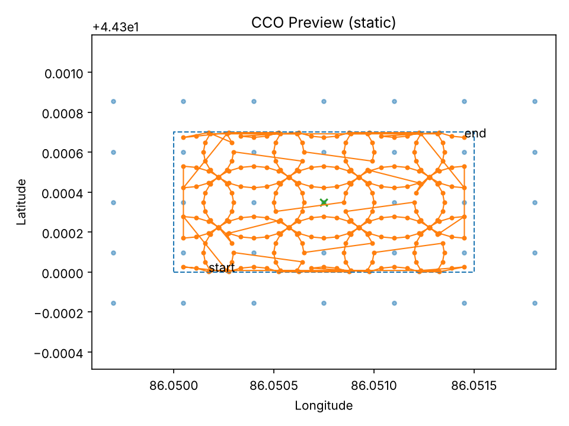

# CCO Flight Planner

[English](README.md) | 中文

根据地块边界生成大疆无人机的交叉环绕倾斜（CCO）航线。程序在 KML 多边形上铺一组等半径的圆，每个圆上布设航点，镜头朝向圆心，输出大疆 WPML 文件（`template.kml` + `waylines.wpml`），并打包成 DJI Pilot 2 可以导入的 KMZ。航点过多的任务会自动拆成几段，保证每段不超过遥控器的航点上限。

我用这种航线拍田间试验来做三维重建。和常规的正射"割草机"航线相比，每个位置都有环绕的倾斜视角，重建出的冠层侧面完整得多，而株高和冠层体积的估算靠的就是这些侧面。DJI Pilot 2 本身没法用圆形航线铺满整块地，所以写了这个工具。



## 安装

需要 Python 3.8 或更高版本。

```bash
git clone https://github.com/smiler488/cco-flight-planner.git
cd cco-flight-planner
pip install -r requirements.txt
```

交互窗口需要 Tk 8.6 及以上（运行 `python -m tkinter` 能弹出窗口即可），或者装 PyQt5 / PySide6。两者都没有时，程序会改用文字提示问答，照样能保存静态的 `preview.png`。

## 使用

### 交互式

```bash
python create_wpml_kml_batch.py
```

先选地块 KML 和输出目录，然后在窗口里调半径、每圈航点数、重叠度、网格旋转角、高度、速度和云台俯仰角，最后点 **Apply & Generate**。用 **Open KML…** 可以直接切换到另一个地块，不用重启程序。不点 Apply 直接关窗口，不会写出任何文件。

键盘操作：`Tab`/`↓` 和 `Shift+Tab`/`↑` 切换滑块，`←`/`→` 微调，按住 `Shift` 步长放大 10 倍。

### 命令行

```bash
python create_wpml_kml_batch.py --polygon examples/demo_field.kml \
  --circle_radius 20 --circle_overlap 0.3 --per_ring 24 \
  --alt 30 --gimbal -45 --speed 6 \
  --drone_enum 99 --drone_sub 1 --payload_enum 89 --payload_sub 0 --payload_pos 0 \
  --max_points 300 --out_dir output
```

加上 `--preview_gui 1`，可以先在窗口里检查、调整布局，再写出文件。

| 参数 | 默认值 | 说明 |
|---|---|---|
| `--polygon` | 必填 | 含 `Polygon` 的 KML（有多个时取第一个） |
| `--circle_radius` | 30 | 圆半径，m |
| `--per_ring` | 60 | 每圈航点数 |
| `--circle_overlap` | 0.3 | 相邻圆的重叠度；圆心间距 = `2r(1 - overlap)` |
| `--center_step` | 0 | 固定圆心间距（m），0 表示按半径和重叠度自动计算 |
| `--cover_padding` | 10 | 布网格前，地块外接框向外扩展的距离（m） |
| `--grid_bearing` | 0 | 网格旋转角（度，顺时针），一般与作物行方向对齐 |
| `--start_bearing` | 0 | 每圈第一个航点的方位角 |
| `--clip_inside` | 1 | 只保留地块内部的航点 |
| `--prune_outside` | 1 | 在 `--clip_inside 0` 时，去掉完全不进入地块的圆 |
| `--alt` / `--speed` / `--gimbal` | 50 / 6 / -45 | 相对起飞点高度（m）、速度（m/s）、云台俯仰角（度） |
| `--file_suffix` | `LiangchaoDeng_SHZU` | 加在每张照片文件名后的后缀 |
| `--max_points` | 300 | 每段任务的最大航点数（0 表示不拆分） |
| `--kmz`、`--pack_full_kmz`、`--pack_parts_kmz` | 1 | 是否写出 KMZ |
| `--center_mode` | `centroid` | 网格原点：多边形质心 `centroid`，或外接框中心 `bbox_center` |
| `--drone_enum` … `--payload_pos` | 无 | 大疆机型和负载编号；不设置就不写入文件 |

图形界面默认填 Matrice 4T 的编号（飞机 `99/1`，负载 `89/0/0`）。命令行方式下，只有显式传参才会写入设备信息。

### 拆分已有航线

`split_wpml_kml_batch.py` 用来拆分其他软件做的航线（DJI Pilot 2、DJI 智图，或者本工具生成的）。`template.kml` 和 `waylines.wpml` 会在相同的航点序号处切开，每段打包成 `partXX.kmz`：

```bash
python split_wpml_kml_batch.py --max 300 --out_dir splits \
  --inputs output/template.kml output/waylines.wpml
```

## 输出

```
output/
├── template.kml      完整任务
├── waylines.wpml
├── cco_full.kmz      wpmz/template.kml + wpmz/waylines.wpml + wpmz/res/
├── preview.png       地块边界、圆心和飞行路径
└── parts/            仅在航点数超过 --max_points 时生成
    ├── template_part01.kml / .wpml
    └── part01.kmz …
```

## 实际使用经验

- 高度相对起飞点（`relativeToStartPoint`），起飞点尽量选在和地块同一高程的位置。
- 每个航点都是"到点悬停"，并执行一次拍照。我的经验是每圈 24–36 个航点，在重叠度和飞行时间之间比较平衡。
- 开启裁剪时，边界附近的圆会变成圆弧，路径会在弧的端点之间跳转，这是正常的。如果希望边缘也飞完整的圆，可以关闭裁剪、打开 prune。
- 整批飞之前，先导入一个 KMZ 到 DJI Pilot 2，在地图上确认航线没问题。

## 本次修订

- 在窗口里用 **Open KML…** 换了地块后，写出时用的仍是最初那个地块，现在改为以屏幕上显示的地块为准。
- 拆分脚本会把每段里的 `droneInfo` / `payloadInfo` 丢掉，现在保留文档层的所有标签。
- 拆分脚本原来把结果写到脚本所在目录，现在改为写到当前目录。
- 高度、速度、云台角可以在窗口里设置了（原来写死为 50 m、6 m/s、-45°）。
- 拍照动作原来固定用 0 号负载位，不理会 `--payload_pos`；`template.kml` 也没有用上 `--file_suffix`。两处都已修正。
- 支持没有 KML 命名空间的文件。
- 原来有三份重复的生成代码，合并成一份；打包 KMZ 时不再创建临时目录。
- 新增 `examples/demo_field.kml`、`requirements.txt`、`CITATION.cff` 和中文 README。

## 引用

```bibtex
@software{deng_cco_flight_planner,
  author = {Deng, Liangchao},
  title  = {CCO Flight Planner: cover-style circular UAV waylines from a field polygon},
  year   = {2025},
  url    = {https://github.com/smiler488/cco-flight-planner}
}
```

## 许可证

MIT，见 [LICENSE](LICENSE)。邓良超（Liangchao Deng）。
